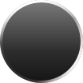

<div align="center">



# Liqui Design

**Liquid glass components for React, built on [Base UI](https://base-ui.com).**

Surfaces that actually refract what is behind them, using a canvas-generated
displacement map and an SVG filter instead of a blur with a white overlay.

English · [简体中文](./README.zh-CN.md)

[Documentation](https://liqui.design) · [Glass handbook](https://liqui.design/docs/handbook/glass) · [Components](https://liqui.design/docs/components/button) · [Theme editor](https://liqui.design/theme) · [Gallery](https://liquidglassdesign.com/?ref=liqui.design)

[](https://www.npmjs.com/package/@liqui-design/glass)
[](./LICENSE)

</div>

---

## Install

```bash
npx shadcn@latest add https://liqui.design/r/button.json
```

That writes `components/ui/button.tsx` into your project, adds the glass design
tokens to your `globals.css`, and installs the `@liqui-design/glass` package.

If you plan to add more than one component, register the namespace once in your
`components.json`:

```json
{
  "registries": {
    "@liqui-design": "https://liqui.design/r/{name}.json"
  }
}
```

```bash
npx shadcn@latest add @liqui-design/button
```

> `@liqui-design/button` is a registry item, not an npm package. The namespace is
> a key in your own `components.json`, and the shadcn CLI resolves it. The only
> thing published to npm is
> [`@liqui-design/glass`](https://www.npmjs.com/package/@liqui-design/glass),
> which the CLI installs for you.

### Requirements

- React 18 or 19
- Tailwind CSS v4

liqui uses the same Base UI base as shadcn/ui (`shadcn init -b base`), so an
existing `components.json`, `cn()` helper and Tailwind token setup carries over
unchanged.

## Usage

```tsx
import { Button } from '@/components/ui/button';

export default function Page() {
  return (
    <main className="min-h-dvh bg-[url(/wallpaper.jpg)] bg-cover p-10">
      <Button variant="accent">Continue</Button>
    </main>
  );
}
```

Note the background. Glass refracts whatever sits behind it, so a surface on a
flat fill has nothing to work with and looks like a slightly grey box. Put these
components over imagery, video, a gradient with real edges, or content that
scrolls underneath.

## What you install

Components arrive as source code in your project. You own the files and edit them
like anything else in your codebase.

The refraction kernel is the exception. The displacement-map maths, the
document-wide SVG filter registry and the browser fallbacks stay in the
`@liqui-design/glass` package, since that is the part you would not want to
maintain by hand.

## Theming

Colour is fourteen `--lq-*` custom properties — the shadcn CLI writes them into
your `globals.css`, and editing them there re-skins everything.

The optics can't be custom properties: refraction is a canvas-generated
displacement map and an SVG filter, so global defaults arrive through
`LiquiThemeProvider` instead. Absolute dials (`material`, `profile`, `finish`,
`frost`, `specular`, `dispersion`, `saturation` and the lighting dials) fill in
what a surface didn't set; geometry (`radiusScale`, `refractionScale`,
`bezelScale`, `blurScale`) multiplies what it did, so a scrollbar thumb and a
drawer stay in proportion.

`finish` chooses how the glass is lit: `classic`, lit along the top and bottom
edges and frosted, or `prism`, one key light from the top left with a dark far
rim and a clear interior. `prismGlassTheme` is the prism finish with the optics
it is drawn for.

The theme editor opens from **Theme** in the header of any page on the site, so
the page you are reading is the preview; [liqui.design/theme](https://liqui.design/theme)
is the full-page version. Either one tunes both halves live and exports exactly
the CSS and the provider you need.
See the [theming handbook](https://liqui.design/docs/handbook/theming).

## Components

| | |
| --- | --- |
| [Accordion](https://liqui.design/docs/components/accordion) | Each item is its own surface, resizing with its panel |
| [Alert Dialog](https://liqui.design/docs/components/alert-dialog) | Modal and un-dismissible, refracting a dimmed scrim |
| [Autocomplete](https://liqui.design/docs/components/autocomplete) | Combobox's surfaces on a field whose value is the text you typed |
| [Avatar](https://liqui.design/docs/components/avatar) | A lens with a picture set into it, inset by the width of its own bezel |
| [Button](https://liqui.design/docs/components/button) | Glass by default; accent and danger are solid fills |
| [Checkbox](https://liqui.design/docs/components/checkbox) | A flat control: hairline box at rest, solid accent when checked |
| [Checkbox Group](https://liqui.design/docs/components/checkbox-group) | Shared state for a stack of checkboxes, with a parent that goes mixed |
| [Collapsible](https://liqui.design/docs/components/collapsible) | A lens on the trigger, frost on the panel that grows |
| [Combobox](https://liqui.design/docs/components/combobox) | A glass field and popup whose height snaps as you filter |
| [Context Menu](https://liqui.design/docs/components/context-menu) | Submenus, checkbox and radio items, keep-mounted popup |
| [Dialog](https://liqui.design/docs/components/dialog) | The dismissible one; its corner close stays flat |
| [Drawer](https://liqui.design/docs/components/drawer) | The largest surface in the library, dragged on one cached map |
| [Field](https://liqui.design/docs/components/field) | Focus and invalid rings on the surface, not the input |
| [Fieldset](https://liqui.design/docs/components/fieldset) | A legend and a gap; the container deliberately isn't a surface |
| [Form](https://liqui.design/docs/components/form) | Server errors routed to the field they belong to |
| [Input](https://liqui.design/docs/components/input) | A transparent input inside a glass surface, with slots on the same lens |
| [Menu](https://liqui.design/docs/components/menu) | A dropdown, kept clear of the glass trigger it hangs from |
| [Menubar](https://liqui.design/docs/components/menubar) | One strip, several menus, and triggers that flatten inside it |
| [Meter](https://liqui.design/docs/components/meter) | A reading on a refracting track, with a wash that changes colour |
| [Navigation Menu](https://liqui.design/docs/components/navigation-menu) | One panel that moves between triggers and snaps to size |
| [Number Field](https://liqui.design/docs/components/number-field) | One group, one lens, and two steppers drawn as divisions of it |
| [OTP Field](https://liqui.design/docs/components/otp-field) | Six identical surfaces that cost one, sharing a cached map |
| [Popover](https://liqui.design/docs/components/popover) | A glass panel with a drawn tail, holding flattened controls |
| [Preview Card](https://liqui.design/docs/components/preview-card) | Popover's surface with the frost turned up |
| [Progress](https://liqui.design/docs/components/progress) | The track is the lens; the fill is a wash laid over it |
| [Radio Group](https://liqui.design/docs/components/radio-group) | A list, not a strip, and every option is a flat control |
| [Scroll Area](https://liqui.design/docs/components/scroll-area) | An overlay scrollbar whose thumb is the smallest lens in the library |
| [Select](https://liqui.design/docs/components/select) | Glass trigger and glass popup, kept from overlapping |
| [Separator](https://liqui.design/docs/components/separator) | A hairline groove cut into the surface |
| [Slider](https://liqui.design/docs/components/slider) | The thumb is the lens; the rail is deliberately flat |
| [Switch](https://liqui.design/docs/components/switch) | The track is the lens; the thumb is deliberately opaque |
| [Tab Bar](https://liqui.design/docs/components/tab-bar) | The iOS floating tab bar, with a lens under your finger |
| [Tabs](https://liqui.design/docs/components/tabs) | The indicator is the lens, sliding along a flat groove |
| [Toast](https://liqui.design/docs/components/toast) | A column rather than a stack, so each one keeps the page behind it |
| [Toggle](https://liqui.design/docs/components/toggle) | A latching button, flat in both states, accent while it is on |
| [Toggle Group](https://liqui.design/docs/components/toggle-group) | One strip, one lens, and toggles that flatten inside it |
| [Toolbar](https://liqui.design/docs/components/toolbar) | One strip of glass with flat controls on it |
| [Tooltip](https://liqui.design/docs/components/tooltip) | The smallest surface, frosted harder so it stays readable |

## Templates

Component pages show one surface at a time. A template is a whole screen, which
is where the material has to hold up: a dozen lenses at once, over a backdrop
with real structure, at the density a product actually ships at.

| | |
| --- | --- |
| [Media Player](https://liqui.design/templates/media-player) | Cover art, transport, library and sound settings. Changing track changes what every surface refracts |

Templates install the same way components do, and bring their components with
them:

```bash
npx shadcn@latest add https://liqui.design/r/media-player.json
```

Cover art and backdrops are generated in CSS, so there are no image files to
copy and nothing to 404 — and gradients with hard edges in them are what
refraction needs anyway.

## Browser support

| | Refraction | Notes |
| --- | :---: | --- |
| Chromium | ✅ | Full displacement refraction |
| Safari | — | Drops `backdrop-filter` entirely when it references an SVG filter. WebKit bug [245510](https://bugs.webkit.org/show_bug.cgi?id=245510) has an implementation in review |
| Firefox | — | Same |

Falling back to frosted blur is automatic and needs no configuration, but check
how it looks. A design tuned with `frost: 0` can end up unreadable once the lens
is gone, because the lens was doing work the tint would otherwise have to do. The
[glass handbook](https://liqui.design/docs/handbook/glass#degradation) goes
through this.

## Background

liqui grew out of [Liquid Glass Design](https://liquidglassdesign.com/?ref=liqui.design),
a curated gallery of liquid glass and glassmorphism references, and the two are
still separate sites. The gallery collects the look; this is the part you can
install.

## Repository

```
packages/glass    @liqui-design/glass, the refraction kernel
apps/www          documentation site, and the registry the CLI installs from
apps/playground   Vite app for tuning the optics against a real backdrop
```

See [CONTRIBUTING.md](./CONTRIBUTING.md) to run it locally or add a component.

## License

[MIT](./LICENSE)
