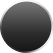

<div align="center">



# Liqui Design

**基于 [Base UI](https://base-ui.com) 的 React 液态玻璃组件库。**

表面会真的折射背后的内容，用 canvas 生成置换贴图配合 SVG 滤镜实现，
而不是一层模糊加一块白色蒙版。

[English](./README.md) · 简体中文

[文档](https://liqui.design) · [玻璃手册](https://liqui.design/docs/handbook/glass) · [组件](https://liqui.design/docs/components/button) · [主题编辑器](https://liqui.design/theme) · [图库](https://liquidglassdesign.com/?ref=liqui.design)

[](https://www.npmjs.com/package/@liqui-design/glass)
[](./LICENSE)

</div>

---

> 站点文档目前只有英文版，本文中的链接都会跳转到英文页面。

## 安装

```bash
npx shadcn@latest add https://liqui.design/r/button.json
```

这条命令会把 `components/ui/button.tsx` 写进你的项目，把玻璃设计令牌加到
`globals.css`，并安装 `@liqui-design/glass` 包。

如果要装多个组件，可以在 `components.json` 里注册一次命名空间：

```json
{
  "registries": {
    "@liqui-design": "https://liqui.design/r/{name}.json"
  }
}
```

```bash
npx shadcn@latest add @liqui-design/button
```

> `@liqui-design/button` 是 registry 条目，不是 npm 包。这个命名空间是你自己
> `components.json` 里的一个键，由 shadcn CLI 负责解析。真正发布到 npm 的只有
> [`@liqui-design/glass`](https://www.npmjs.com/package/@liqui-design/glass)，
> CLI 会自动帮你装上。

### 环境要求

- React 18 或 19
- Tailwind CSS v4

liqui 和 shadcn/ui 用的是同一套 Base UI 基础（`shadcn init -b base`），所以你已有的
`components.json`、`cn()` 和 Tailwind 令牌配置都能直接沿用。

## 用法

```tsx
import { Button } from '@/components/ui/button';

export default function Page() {
  return (
    <main className="min-h-dvh bg-[url(/wallpaper.jpg)] bg-cover p-10">
      <Button variant="accent">Continue</Button>
    </main>
  );
}
```

注意那个背景。玻璃折射的是它背后的东西，放在纯色填充上就没有可折射的内容，看起来只会是
一个略微发灰的方块。把组件放到图片、视频、有明显边界的渐变，或者会从下方滚过的内容上面。

## 你装到的是什么

组件是以源码形式进到你项目里的，文件归你所有，跟你自己写的组件一样随便改。

例外是折射内核。置换贴图的计算、全文档范围的 SVG 滤镜注册表和浏览器兜底方案都留在
`@liqui-design/glass` 包里，这部分不适合手工维护。

## 主题

颜色就是十四个 `--lq-*` 自定义属性 —— shadcn CLI 会把它们写进你的
`globals.css`，改那里就等于换掉整套皮肤。

光学部分做不成自定义属性：折射是 canvas 生成的置换贴图加一个 SVG 滤镜，所以全局
默认值走 `LiquiThemeProvider`。绝对量（`material`、`profile`、`finish`、`frost`、
`specular`、`dispersion`、`saturation` 以及几个光照参数）用来补上组件没设的值；几何量
（`radiusScale`、`refractionScale`、`bezelScale`、`blurScale`）则是乘在组件自己设的值上，
这样滚动条滑块和抽屉之间的比例不会被拉垮。

`finish` 决定玻璃怎么打光：`classic` 是上下两条边受光、带磨砂；`prism` 是左上方一盏
主光，远端一圈暗边，中间清透。`prismGlassTheme` 是 prism 加上它配套的光学参数。

主题编辑器可以在站点任意页面的 header 里点 **Theme** 打开，正在看的页面就是预览；
[liqui.design/theme](https://liqui.design/theme) 是整页版本。两者都能实时调这两半，并导出
你需要的 CSS 和 provider 代码。详见[主题手册](https://liqui.design/docs/handbook/theming)。

## 组件

| | |
| --- | --- |
| [Accordion](https://liqui.design/docs/components/accordion) | 每一项都是独立的表面，随面板一起改变尺寸 |
| [Alert Dialog](https://liqui.design/docs/components/alert-dialog) | 模态且不可随手关闭，折射一层压暗的遮罩 |
| [Autocomplete](https://liqui.design/docs/components/autocomplete) | Combobox 的表面，配在一个以输入文字为值的字段上 |
| [Avatar](https://liqui.design/docs/components/avatar) | 一枚透镜里嵌一张图，内缩距离等于它自己的 bezel 宽度 |
| [Button](https://liqui.design/docs/components/button) | 默认是玻璃；强调色与危险色是实心填充 |
| [Checkbox](https://liqui.design/docs/components/checkbox) | 扁平控件：静息是细描边方框，选中是实心强调色 |
| [Checkbox Group](https://liqui.design/docs/components/checkbox-group) | 一组复选框共享状态，父级在部分选中时显示为混合态 |
| [Collapsible](https://liqui.design/docs/components/collapsible) | 触发器是透镜，展开的面板用磨砂 |
| [Combobox](https://liqui.design/docs/components/combobox) | 玻璃输入框加玻璃弹层，筛选时高度按档跳变 |
| [Context Menu](https://liqui.design/docs/components/context-menu) | 支持子菜单、复选与单选项，弹层可保持挂载 |
| [Dialog](https://liqui.design/docs/components/dialog) | 可关闭的那一个，角上的关闭按钮保持扁平 |
| [Drawer](https://liqui.design/docs/components/drawer) | 库里最大的表面，拖动时只用一张缓存贴图 |
| [Field](https://liqui.design/docs/components/field) | 聚焦环和错误环画在表面上，而不是 input 上 |
| [Fieldset](https://liqui.design/docs/components/fieldset) | 一个图例加一段间距，容器刻意不做成表面 |
| [Form](https://liqui.design/docs/components/form) | 把服务端错误分派到对应的字段上 |
| [Input](https://liqui.design/docs/components/input) | 玻璃表面里的透明输入框，两侧插槽共用同一枚透镜 |
| [Menu](https://liqui.design/docs/components/menu) | 下拉菜单，与作为触发器的玻璃按钮保持不重叠 |
| [Menubar](https://liqui.design/docs/components/menubar) | 一条玻璃承载多个菜单，触发器在其中扁平化 |
| [Meter](https://liqui.design/docs/components/meter) | 折射轨道上的读数，色晕会变色但不会滑动 |
| [Navigation Menu](https://liqui.design/docs/components/navigation-menu) | 一块面板在各个触发器之间移动，并按档调整尺寸 |
| [Number Field](https://liqui.design/docs/components/number-field) | 一块玻璃一个镜面，加减按钮只是它的分区 |
| [OTP Field](https://liqui.design/docs/components/otp-field) | 六个相同的表面只花一份成本，共用同一张缓存贴图 |
| [Popover](https://liqui.design/docs/components/popover) | 带指示尾巴的玻璃面板，内部承载扁平化的控件 |
| [Preview Card](https://liqui.design/docs/components/preview-card) | Popover 的表面，磨砂调得更重 |
| [Progress](https://liqui.design/docs/components/progress) | 轨道是透镜，填充只是覆在其上的一层色晕 |
| [Radio Group](https://liqui.design/docs/components/radio-group) | 它是一份列表而非一条整块，每个选项都是扁平控件 |
| [Scroll Area](https://liqui.design/docs/components/scroll-area) | 覆盖式滚动条，滑块是库里最小的透镜 |
| [Select](https://liqui.design/docs/components/select) | 玻璃触发器配玻璃弹层，并避免两者重叠 |
| [Separator](https://liqui.design/docs/components/separator) | 刻进表面的一道细槽 |
| [Slider](https://liqui.design/docs/components/slider) | 滑块是那枚透镜，轨道刻意保持扁平 |
| [Switch](https://liqui.design/docs/components/switch) | 轨道是透镜，滑块刻意保持不透明 |
| [Tab Bar](https://liqui.design/docs/components/tab-bar) | iOS 风格的浮动标签栏，手指下面是一枚透镜 |
| [Tabs](https://liqui.design/docs/components/tabs) | 指示器才是透镜，在扁平的凹槽里滑动 |
| [Toast](https://liqui.design/docs/components/toast) | 通知排成一列，每个表面背后都留着页面 |
| [Toggle](https://liqui.design/docs/components/toggle) | 会保持按下状态的按钮，两种状态都扁平，打开时填充强调色 |
| [Toggle Group](https://liqui.design/docs/components/toggle-group) | 一条玻璃，一枚透镜，里面的按钮全部扁平化 |
| [Toolbar](https://liqui.design/docs/components/toolbar) | 一条玻璃上放一排扁平控件 |
| [Tooltip](https://liqui.design/docs/components/tooltip) | 最小的表面，磨砂更重以保证可读性 |

## 模板

组件页一次只展示一个表面。模板是一整屏，而这才是这套材质需要经得起考验的地方：
十几枚透镜同时在场，背景有真实结构，密度是产品真正会用到的密度。

| | |
| --- | --- |
| [Media Player](https://liqui.design/templates/media-player) | 封面、播放控制、曲库和音效设置。切换曲目会改变每一个表面所折射的内容 |

模板的安装方式与组件一致，并会把它用到的组件一并带上：

```bash
npx shadcn@latest add https://liqui.design/r/media-player.json
```

封面和背景都由 CSS 生成，所以没有图片文件需要复制，也不会有 404 —— 何况带硬边的
渐变本来就是折射需要的东西。

## 浏览器支持

| | 折射 | 说明 |
| --- | :---: | --- |
| Chromium | ✅ | 完整的置换折射 |
| Safari | — | 只要 `backdrop-filter` 引用了 SVG 滤镜就会被整个丢弃。WebKit bug [245510](https://bugs.webkit.org/show_bug.cgi?id=245510) 的实现正在评审中 |
| Firefox | — | 同上 |

降级到磨砂模糊是自动的，不需要任何配置，但还是要亲自看一眼效果。按 `frost: 0` 调好的
设计在透镜消失后可能变得难以阅读，因为原本由透镜承担的工作会全部落到着色上。
[玻璃手册](https://liqui.design/docs/handbook/glass#degradation)里有详细说明。

## 项目由来

liqui 源自 [Liquid Glass Design](https://liquidglassdesign.com/?ref=liqui.design)，
一个收录液态玻璃与毛玻璃设计参考的策展图库，两者至今是各自独立的站点。图库收集这种视觉
风格，而这里是你可以直接装进项目的那部分。

## 仓库结构

```
packages/glass    @liqui-design/glass，折射内核
apps/www          文档站点，以及 CLI 安装时读取的 registry
apps/playground   Vite 应用，用于对着真实背景调试光学参数
```

本地运行或新增组件，见 [CONTRIBUTING.md](./CONTRIBUTING.md)。

## 许可

[MIT](./LICENSE)
